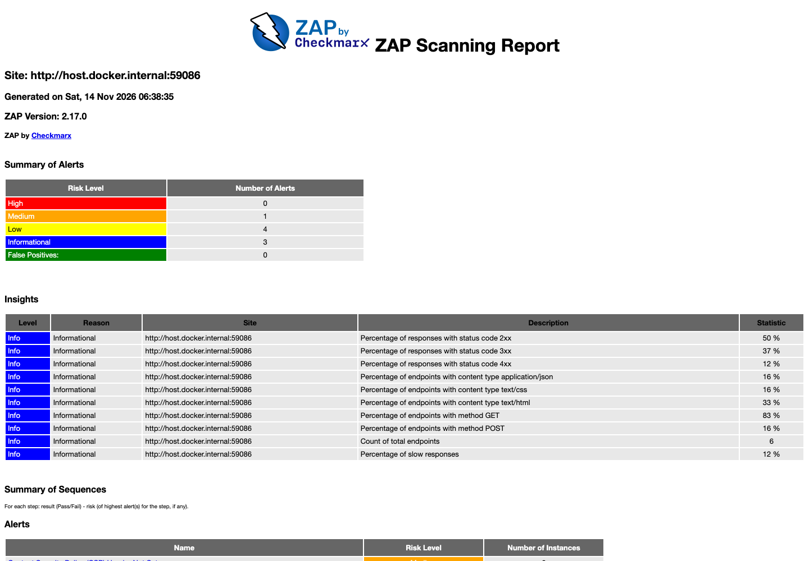
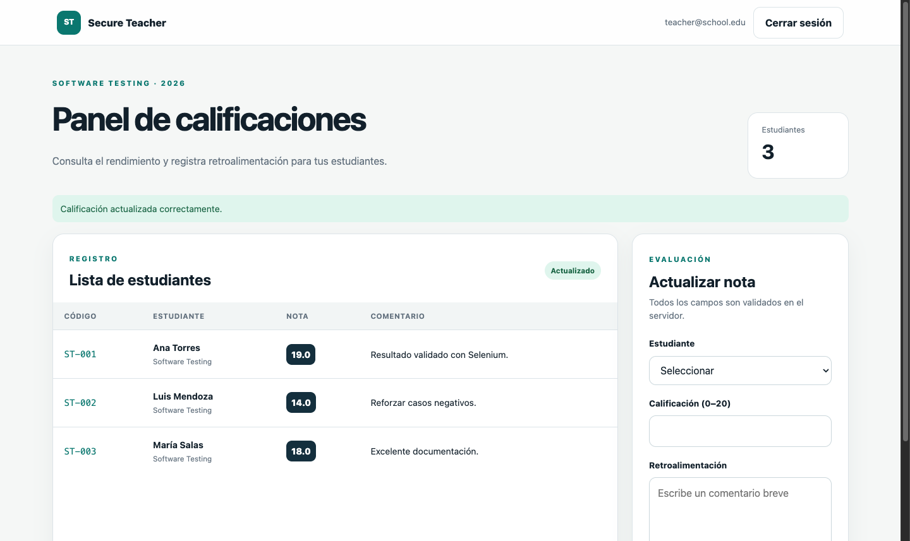
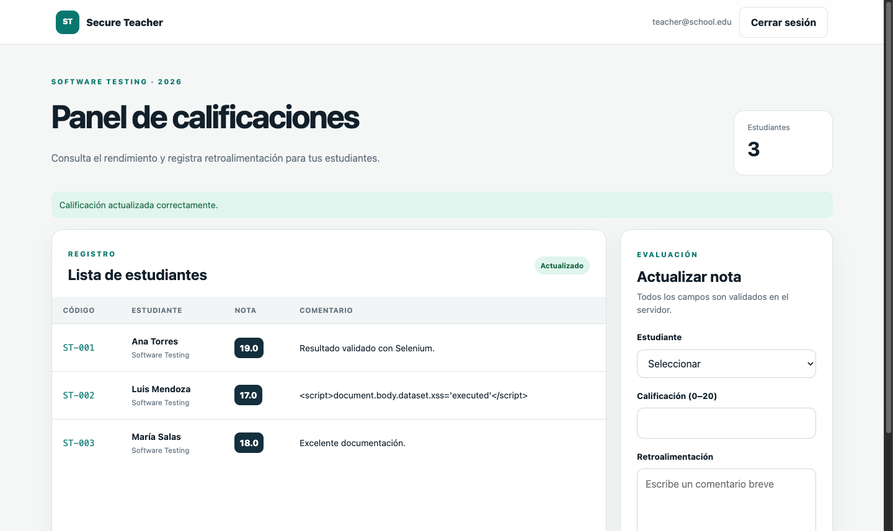

# Informe breve de seguridad

## Datos generales

- **Proyecto:** Secure Teacher Portal
- **Estudiante:** Víctor Raúl Torreblanca Franco
- **Herramienta:** OWASP ZAP 2.17.0, Baseline Scan
- **Objetivo analizado:** `http://host.docker.internal:59086/login`
- **Fecha:** 14 de noviembre de 2026

## Objetivo y alcance

Evaluar de forma pasiva la pantalla de acceso y los recursos públicos del portal docente. El escaneo baseline utiliza el spider de ZAP y reglas pasivas, por lo que no realiza ataques activos ni modifica la información de la aplicación.

## Resultado inicial

El primer análisis detectó **0 alertas altas, 1 media, 4 bajas y 3 informativas**.

| Hallazgo | Riesgo | Interpretación | Medida aplicada |
|---|---|---|---|
| Content Security Policy ausente | Medio | El navegador no tenía una política explícita que limitara scripts, estilos, formularios y objetos. Esto aumenta el impacto potencial de un XSS. | Se agregó una CSP restrictiva con recursos del mismo origen, bloqueo de objetos y `frame-ancestors 'none'`. |
| COEP, COOP y CORP ausentes | Bajo | Faltaba aislamiento explícito frente a recursos y ventanas de otros orígenes. | Se añadieron `Cross-Origin-Embedder-Policy`, `Cross-Origin-Opener-Policy` y `Cross-Origin-Resource-Policy`. |
| Permissions Policy ausente | Bajo | El navegador no recibía restricciones explícitas para cámara, micrófono y ubicación. | Se deshabilitaron esas capacidades porque el portal no las necesita. |
| Contenido no almacenable | Informativo | Spring Security evita almacenar páginas sensibles en caché. Es un comportamiento esperado, no un defecto. | Se conserva la configuración para proteger información del usuario. |
| Solicitud de autenticación y sesión detectadas | Informativo | ZAP reconoció correctamente el formulario de acceso y la cookie de sesión. | Se verificó que la cookie sea `HttpOnly` y `SameSite=Strict`. |

## Controles adicionales verificados

- Contraseña almacenada internamente con BCrypt.
- Autorización obligatoria para acceder al panel.
- Token CSRF automático en formularios POST.
- Validación del rango de calificaciones en el backend.
- Escape de salida de Thymeleaf frente a intentos XSS.
- Cookies de sesión con `HttpOnly` y `SameSite=Strict`.
- Cabeceras `X-Content-Type-Options`, `X-Frame-Options` y `Referrer-Policy`.

## Verificación posterior

Después de aplicar las cabeceras se repitió exactamente el mismo escaneo. El resultado final fue:

- **0 alertas altas**
- **0 alertas medias**
- **0 alertas bajas**
- **3 alertas informativas esperadas**
- **65 reglas aprobadas**

Los tres avisos restantes describen el uso de autenticación, sesiones y contenido no almacenable. No representan vulnerabilidades explotables en este alcance.

## Evidencias funcionales

### Actualización de una calificación

### Validación de salida contra XSS

## Medidas preventivas recomendadas

1. Desplegar la aplicación exclusivamente mediante HTTPS y activar HSTS en producción.
2. Sustituir las credenciales de demostración por usuarios almacenados en una base de datos segura.
3. Mantener Spring Boot, Selenium y la imagen de ZAP actualizados.
4. Ejecutar pruebas Selenium y un escaneo ZAP en cada cambio relevante.
5. No registrar contraseñas, tokens o datos personales en logs.

## Conclusión del análisis

El análisis inicial permitió identificar configuraciones defensivas ausentes sin encontrar inyección SQL, ejecución XSS ni fallos críticos. La corrección redujo las alertas medias y bajas a cero, y las pruebas automatizadas confirmaron que la funcionalidad principal continuó operando correctamente.

El informe completo generado por la herramienta está disponible en [`zap-reports`](zap-reports).

Fuente metodológica: [documentación oficial del ZAP Baseline Scan](https://www.zaproxy.org/docs/docker/baseline-scan/).
